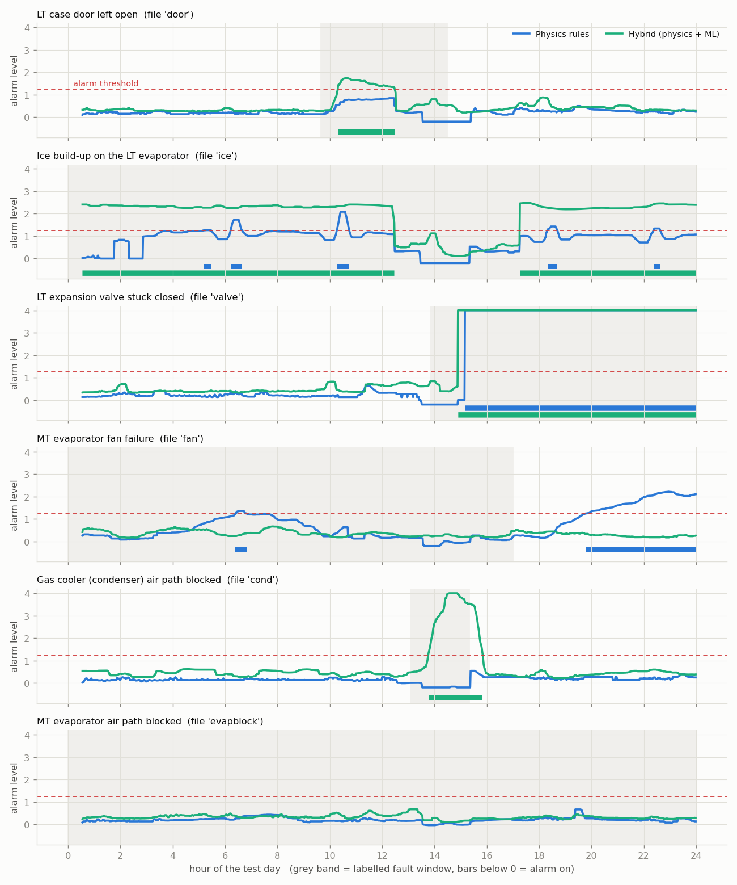
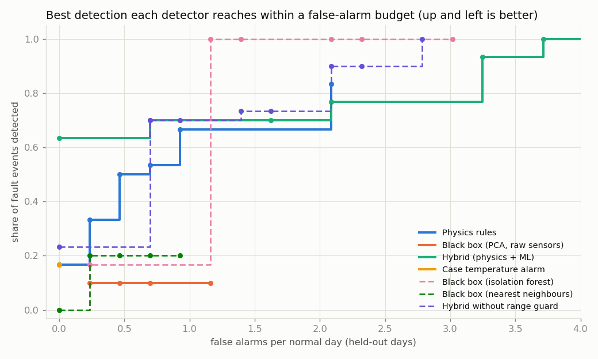
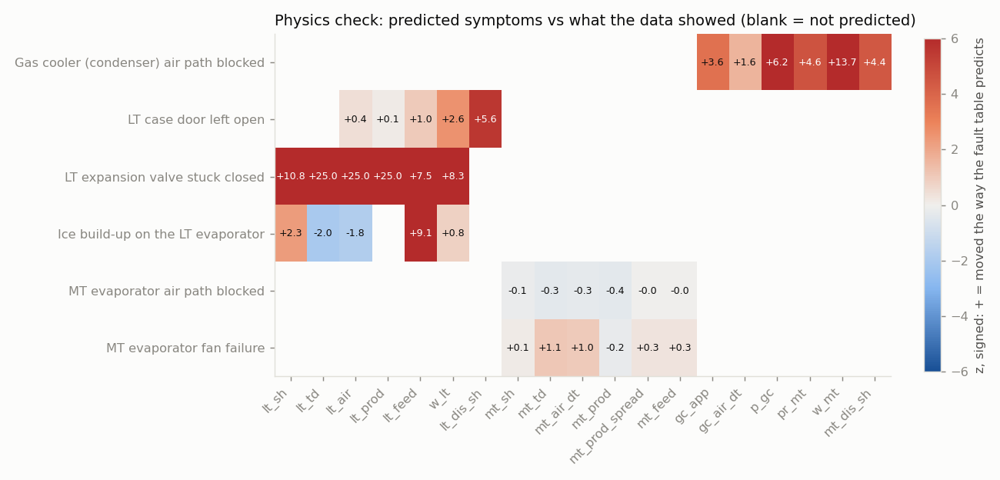
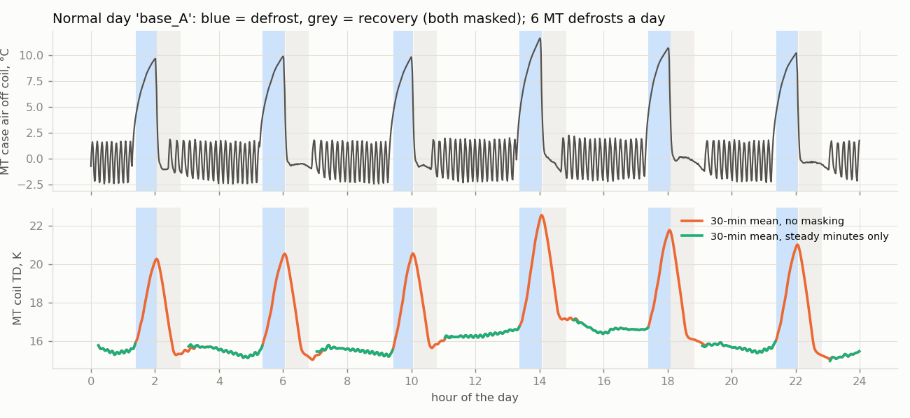
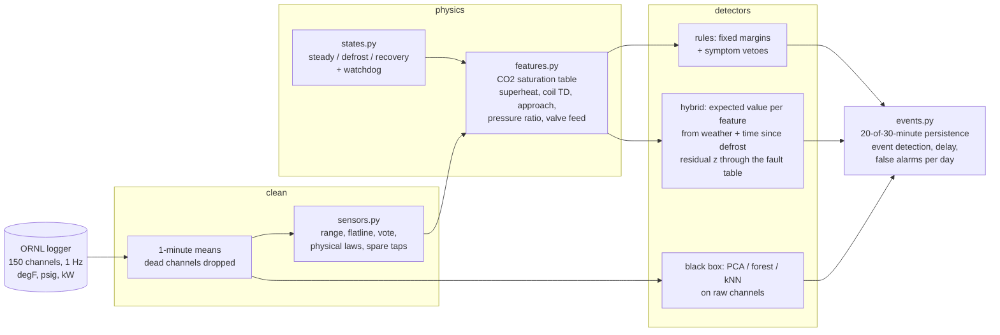

# Fault detection for a supermarket refrigeration system

[](https://github.com/Praruj/refrigeration-fdd/actions/workflows/ci.yml)

[](LICENSE)

This project finds faults in a CO2 supermarket refrigeration system from its sensor data, and names the fault.
It uses open lab data from Oak Ridge National Laboratory: one compressor rack, one frozen-food case (LT, about
-20 °C) and one chilled case (MT, about +2 °C), with 6 faults put in on purpose.

I compare three ways to do it, all scored the way a service team would judge them: **per fault event**
(was it caught, how fast, was the right fault named) and **false alarms per normal day**. Row-level accuracy
is never used, and finding 5 shows why.

1. **Physics rules**: the fault table a refrigeration engineer would write, with fixed limits.
2. **Black box**: anomaly detection on all ~150 raw sensor channels, no physics.
3. **Hybrid**: physics features from the refrigeration cycle, plus a small ML model that predicts what each
   feature *should* be under today's weather, and then reads the gaps through the same fault table.

Everything runs on a laptop CPU with free tools. One command, `python -m rfdd.pipeline --config configs/ornl.yaml`
(about 9 minutes after a 1 GB download), produces every number below and writes them to
[`results/ornl/results.json`](results/ornl/results.json).

| 6 fault events, 5 normal days, leave-one-normal-day-out | Events caught in every fold | Right fault named | Median time to alarm | False alarms per normal day |
|---|---|---|---|---|
| Physics rules | 3 of 6 | 2 of the 3 | 310 min | 0.46 |
| Black box (PCA on raw sensors) | 0 of 6 | - | - | 0.23 |
| **Hybrid (physics + ML)** | **4 of 6** | **4 of 4** | **39 min** | 0.70 |
| Case temperature alarm (what a controller does today) | 1 of 6 | - | 64 min | 0 |

*Alarm threshold fixed in advance at 1.25 × the highest score any held-out normal day reached in training.*

Without any threshold choice: **with zero false alarms on all 5 held-out normal days, the hybrid still catches
63% of fault events.** The rules catch 17%, and no black box catches anything at that budget (figure in finding 2).



*Each panel is one test day. Grey band: the fault window. Bars under the zero line: when each detector's alarm
was on. Red dashed line: the alarm threshold.*

## What I found

**1. Physics features plus a "what is normal today" model beat both rules and black boxes.** The hybrid caught
the door left open, the iced coil, the stuck valve and the blocked gas cooler, in every fold, and named the
right fault every time, 33 to 64 minutes after it started. The rules caught the iced coil about 4.5 hours later than the
hybrid and missed the door and the gas cooler. The rules also "caught" the fan failure, but by naming the gas
cooler: it was a cold night, and at low outdoor temperature the gas-cooler approach widens on a healthy plant.
That is exactly the trap the hybrid avoids, because it learns approach as a function of outdoor temperature.

| Fault | Physics rules | Black box | Hybrid |
|---|---|---|---|
| LT case door left open | missed | missed | 5/5 folds, 39 min, door |
| Ice on the LT evaporator | 5/5, 310 min, ice | 1/5 | 5/5, 33 min, ice |
| LT expansion valve stuck closed | 5/5, 80 min, valve | 1/5 | 5/5, 64 min, valve |
| MT evaporator fan failure | 5/5, 384 min, **wrong fault** | missed | missed |
| Gas cooler air path blocked | missed | 1/5 | 5/5, 41 min, gas cooler |
| MT evaporator air path blocked | missed | missed | missed |

**2. Black boxes on raw sensors fail here, and it is not a tuning problem.** I tried three (PCA reconstruction
error, isolation forest, nearest neighbours). None catches any event in every fold. The reason is that the plant
moves far more with the weather than with any fault: the five normal days span -2 °C to 34 °C outdoors, and
head pressure, compressor power and discharge temperatures swing with it. With five days of history, a black box
cannot tell "hotter than any day I have seen" from "broken". Allowed more than about one false alarm a day, the
isolation forest does reach 100%, but only because it alarms on most days, normal ones included.



**3. The physics was mostly right, and the data showed where it was not.** For each fault I wrote down, before
fitting, which features should move and which way (`faults.py`). Then I measured each one against the model's
expectation, in units of normal day-to-day noise:
- Gas cooler blockage: all 6 symptoms confirmed (head pressure +540 kPa, compressor power +3.3 kW, approach +2.4 K).
- Stuck valve: all 6 confirmed (superheat +21 K, case air +22 K, LT compressor power down).
- Door open: 3 of 5 confirmed. LT compressor power and discharge temperature rose; case air barely moved,
  because the controller absorbed the extra load.
- Ice: 2 of 5 confirmed, 2 **opposite**. The valve fed almost all day and superheat fell, as predicted, but the
  case air and coil temperature difference went *down*, not up. The iced coil kept over-cooling its air rather
  than starving it. I report this instead of changing the table to fit.
- MT fan failure and MT air-path blockage: nothing visible beyond normal noise in any MT feature. These two
  faults are not detectable from these sensors on these days (see *Limitations*).



**4. False-alarm control: defrost masking and a sensor check both earn their place.**

*Defrost.* The MT case defrosts 6 times a day and the LT case once. During and after a defrost every evaporator
feature leaves its normal range. The pipeline tags each minute as steady, defrost or recovery, and judges case
faults on steady minutes only. A watchdog ends the mask if a "defrost" runs too long, so a valve stuck shut
cannot hide behind it (the valve fault is caught that way). Without the mask, the hybrid looks better on paper
(6 of 6 events at 1 false alarm a day), but **only 2 of those 6 are caught for the right reason**: the rest are
defrosts that happen to fall inside fault windows. With the mask, all 4 detections name the right fault.



*Sensors.* Before any fault logic, every sensor is checked: range, flatline, a two-of-three vote between the
redundant suction-pressure taps, and physical laws (suction gas cannot be colder than its saturation
temperature; refrigerant cannot leave the gas cooler colder than the air cooling it). A sensor that fails is
removed, and a healthy redundant tap stands in for it. I injected 12 sensor faults into held-out normal days:

| Injected sensor fault | Caught by | Flagged | Process false alarm, check on | ...check off |
|---|---|---|---|---|
| Suction pressure −200 kPa / +300 kPa | three-way vote | 5/5 days | 1/5 and 0/5 | 5/5 |
| Head pressure +600 kPa | pair disagreement | 5/5 | 0/5 | 5/5 |
| Gas-cooler outlet −8 K | physical law | 5/5 | 0/5 | 5/5 |
| MT suction temperature −15 K | physical law | 5/5 | 2/5 | 5/5 |
| LT return air stuck | flatline | 5/5 | 0/5 | 2/5 |
| Outdoor air +5 K | nothing (no second sensor) | 0/5 | 4/5 | 4/5 |

Where there is redundancy or a physical law to break, the check turns a sensor fault from a false process alarm
into a "replace this probe" message. Where there is neither (outdoor air, one suction thermocouple), it cannot.
Real data agreed: in one "normal" baseline file (E) the MT case return-air probe reads about 35 °C all day,
warmer than the room around the case. The check flagged it and removed it without being told.

**5. Row-level accuracy would have told a nice lie.** A gradient-boosted classifier on raw sensors, scored on a
random split of minutes, separates each fault day from its normal day with 100% accuracy. It also separates two
*normal* days from each other with 100% accuracy. It is recognising the day (weather, load), not the fault.
That is why every number here is per event, with whole days held out.

**6. One "normal" day was not normal.** Baseline C (August) shows the MT case running 4 K warmer, with a 5 K
larger air drop across the coil and the valve feeding about 100% of the time, from 07:25 for the rest of the day.
I set this period aside by eye before modelling (it is listed in `configs/ornl.yaml`), and it is neither
trained on nor counted as a false alarm. The hybrid alarms on 527 of its 995 minutes anyway, so the model
independently agrees something was wrong.

## How it works



**Physics features** ([`features.py`](src/rfdd/features.py)). Pressures go through a CO2 saturation table (from
CoolProp, stored in [`co2.py`](src/rfdd/co2.py) so the pipeline needs no thermodynamics library) to get
evaporating temperatures. From those: evaporator superheat, coil temperature difference (return air minus
evaporating temperature) and valve-feed fraction for each case; gas-cooler approach and air-side temperature
rise; head pressure, compressor pressure ratio, power and discharge superheat. 19 features in all, each a
30-minute trailing mean (longer than one compressor cycle), each causal (a unit test checks it).

**Fault table** ([`faults.py`](src/rfdd/faults.py)). Each fault has a written explanation and the direction in
which each symptom should move. The two MT airflow faults share one signature, so they are scored as one group
("MT coil airflow"): the sensors cannot tell a dead fan from a blocked grille.

**Rules** ([`models.py`](src/rfdd/models.py)). A fault fires when at least two of its symptoms pass fixed
engineering margins (for example 4 K of superheat, 3 K of approach) and none of its symptoms points clearly the
other way. Weather-driven features (head pressure, compressor power) are left out, because a fixed limit on
them only detects hot days.

**Hybrid** ([`models.py`](src/rfdd/models.py)). For each feature, a small regression predicts its normal value from
the conditions it depends on (outdoor air, room air, minutes since the last defrost). The model family (median,
ridge or gradient-boosted trees) is picked per feature by leave-one-day-out error inside the training days. The
residual is divided by the model's error on a day it has not seen, with a floor set by instrument accuracy, so
day-to-day variation counts as noise. Evidence for each fault is the sum of its symptoms' residuals in the
predicted directions, divided by √n: agreeing symptoms add up and contradicting ones subtract. A last score,
"unknown", is the largest residual of any feature, for faults outside the table. Outside the outdoor and room
temperatures seen in training, the model abstains for weather-driven features instead of extrapolating (the
"range guard"; without it, false alarms more than double, see the table below).

**Alarm logic** ([`events.py`](src/rfdd/events.py)). An alarm needs the score above threshold in 20 of the last 30
minutes. Episodes closer than 30 minutes merge. The same logic is used for every detector.

**Evaluation** ([`evaluate.py`](src/rfdd/evaluate.py)). No detector is ever trained on a fault: each fault exists
on exactly one day, and a classifier trained on it would mostly learn which day it is (finding 5). Instead:
- Each of the 5 normal days is held out in turn. Every detector is trained on the other 4 (thresholds included),
  then scores the held-out normal day (false alarms) and all 6 fault days (detections).
- "Caught in every fold" means caught whichever 4 normal days were used for training.
- "For the right reason" means no wrong fault was named. Black boxes cannot name faults, so they get the
  benefit of the doubt.

**Labels.** The data descriptor labels whole files and gives no time schedule. I set each fault window from the
most direct signal for that fault, and wrote the evidence next to each window in
[`configs/ornl.yaml`](configs/ornl.yaml). For example, the gas-cooler blockage is 13:05 to 15:20, where head pressure
and compressor power step up and back. For three faults (ice, fan, MT blockage) the whole file is used, because
there is no visible onset.

| Detector | Caught in every fold | False alarms / normal day | Normal days with an alarm |
|---|---|---|---|
| Hybrid | 4 / 6 | 0.70 | 1 / 5 |
| Hybrid without range guard | 4 / 6 | 1.62 | 2 / 5 |
| Black box, isolation forest | 0 / 6 | 0 | 0 / 5 |
| Black box, nearest neighbours | 0 / 6 | 0.70 | 1 / 5 |

All tables, including the full threshold sweep, are in [`results/ornl/tables.md`](results/ornl/tables.md).

## Run it

```bash
python -m venv .venv && .venv/Scripts/activate   # or source .venv/bin/activate
pip install -e ".[dev,api,app]"
pytest                                                     # 24 tests, under a minute
python -m rfdd.pipeline --config configs/smoke.yaml        # synthetic fixture, no download, used by CI
python -m rfdd.pipeline --config configs/ornl.yaml         # downloads the data (1 GB, MD5-checked), ~9 min
python -m rfdd.report results/ornl                         # regenerates results/ornl/tables.md
streamlit run app/streamlit_app.py                         # interactive demo
uvicorn app.api:app --port 8000                            # scoring API
```

**Demo.** Pick any of the 11 test days and drag the time slider. It shows the hybrid and rules alarm levels so
far, the diagnosis, the case states, and the five features furthest from their expected values, with measured
and expected values side by side.

**API.** `POST /score` takes at least 30 minutes of 1-minute readings (named signals in SI units, listed in
[`service.py`](src/rfdd/service.py)) and returns the alarm state, the diagnosis, untrusted sensors and the evidence.
`GET /faults` returns the fault table. `GET /health` reports whether a model is loaded.

```
src/rfdd/
  data.py        download (MD5 against the figshare record), clean, 1-minute resampling
  signals.py     raw logger tags -> named SI signals
  co2.py         CO2 saturation table
  sensors.py     sensor-fault checks, spare-tap substitution, fault injection
  states.py      steady / defrost / recovery tagging with watchdog
  features.py    the 19 physics features
  faults.py      the fault table and rule margins
  models.py      rules, hybrid, black boxes, case temperature alarm
  events.py      alarm persistence, event and false-alarm scoring
  evaluate.py    leave-one-normal-day-out folds, threshold sweep
  studies.py     physics check, sensor injections, masking ablation, row-accuracy trap
  synth.py       synthetic fixture for CI and tests
  pipeline.py, plots.py, report.py, service.py
app/             api.py (FastAPI), streamlit_app.py
configs/         ornl.yaml (full, with fault windows and evidence), smoke.yaml (CI)
results/ornl/    results.json, tables.md, model.pkl, demo_features.csv.gz, figures/
```

CI (GitHub Actions) runs ruff, mypy, the tests (including the API) and the smoke pipeline on synthetic data, so
it needs no download.

## Limitations

- **Small data.** 5 normal days and 6 fault events from one lab system. Every number here moves if one day
  changes. I report counts ("4 of 6") rather than percentages with decimals for that reason, and I do not claim
  the hybrid is significantly better than the rules on 6 events.
- **One hot normal day.** All of the hybrid's false alarms (3 episodes) are on baseline B, the July day. When it
  is held out, the only other summer reference is half of baseline C. On that day LT superheat sits about 4 noise units low and the LT coil temperature difference 3.5 units high,
  and the hybrid names it "ice". That is the ice fault's own pattern, and the ice test ran on the same rig one
  week later. It may be early frost, or just summer conditions the other days do not cover. With one hot normal
  day I cannot tell, so I count it as a false alarm. More summer history is the fix; a lower threshold is not.
- **Two faults not detected.** The MT fan failure and MT air-path blockage left no mark beyond normal noise on the
  MT features. The descriptor gives severities (25%, 50%, 75%) but not when each was applied, so part of each
  "fault" day may have been at the mildest level. A few individual shelf probes do shift during the fan fault, but
  the shelf average does not, and I did not add per-probe features after seeing the result.
- **Labels are mine.** The fault windows come from reading the data, with the evidence written next to each. A
  different reading would change delays by minutes, not which events are caught.
- **No refrigerant leak.** The data set has no leak or undercharge test, the most common field fault. Superheat and
  valve feed are the classic leak symptoms and are in the feature set, but leak detection is untested here.
- **Sensor faults without redundancy are not caught.** A 5 K error on the outdoor air sensor still causes false
  alarms on 4 of 5 days. A biased probe is only caught once the process pushes it across a physical limit, which
  can take an hour.
- **Lab, not field.** Loads come from heaters and doors are opened by a machine, so there are no shoppers,
  restocking or night blinds. Field data would add all of those transients.

## Data and references

- Data: J. Sun, P. Im, Y. Bae, J. Munk, T. Kuruganti, B. Fricke, "Dataset of low global warming potential
  refrigerant refrigeration system for fault detection and diagnostics", *Scientific Data* 8, 144 (2021).
  Files: figshare, DOI [10.6084/m9.figshare.13232627](https://doi.org/10.6084/m9.figshare.13232627),
  licensed CC BY 4.0. Raw files are not committed; the pipeline downloads them and checks every MD5.
  `results/ornl/demo_features.csv.gz` is derived from them (1-minute physics features) under the same licence.
- CO2 properties: Span and Wagner equation of state, via CoolProp (I. Bell et al., *Ind. Eng. Chem. Res.* 53, 2014).
- Event-based FDD evaluation background: J. Granderson et al., "Building fault detection data to aid diagnostic
  algorithm creation and performance testing", *Scientific Data* 7, 65 (2020).

MIT licence (code). Code by Praruj Thapa.
